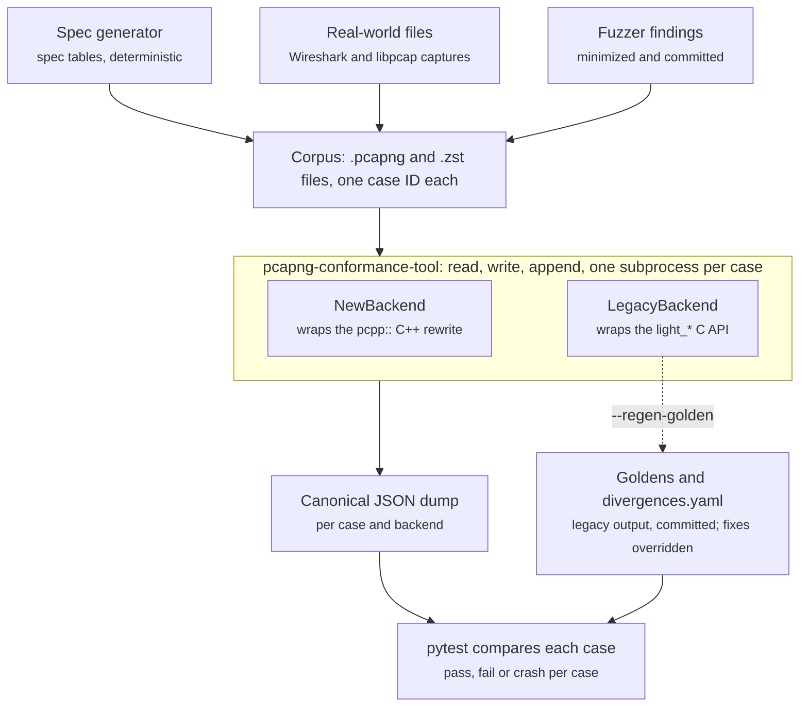

# PcapNgPlusPlus: Conformance Test Plan

This is the working plan for replacing LightPcapNg with a C++14 implementation. Update it in the same PR as the work it describes: tick milestone items, add decisions to the log, and move resolved questions out of the open list.

## Goal and scope

Build a conformance suite, before writing any new code, that proves a C++14 rewrite of LightPcapNg behaves like the current C code: no new bugs, no leaks, no extra memory, no slowdown.

**The contract.** PcapPlusPlus uses 11 functions from `light_pcapng_ext.h`: `light_pcapng_open_read`, `light_pcapng_open_write`, `light_pcapng_open_append`, `light_create_default_file_info`, `light_create_file_info`, `light_free_file_info`, `light_pcang_get_file_info`, `light_get_next_packet`, `light_write_packet`, `light_pcapng_flush`, `light_pcapng_close`. Everything is tested through this boundary.

**The input space is the whole pcapng format.** Reading or appending a file runs the generic block and option parser in `light_pcapng.c` on whatever the file contains. Coverage is therefore defined by pcapng content, not by the API.

**Out of scope.** Code that PcapPlusPlus can't reach (`light_advanced.c`, `light_manipulate.c`, flow, histogram, split, and LightPcapNg's own `src/tests/`) is neither tested nor ported.

**Success criteria**

- Every case matches the golden output, except cases listed in `divergences.yaml`.
- Over 95% branch coverage of the legacy code that is reachable from the 11 functions, with every remaining gap explained.
- Zero leaks and zero sanitizer reports on the full corpus, for both implementations.
- New code's peak heap is at most 110% of legacy's, per case; allocations per packet in steady state are at most legacy's.
- New code's throughput is at least 95% of legacy's on every benchmark.
- Differential fuzzing runs 24 hours with no unexplained mismatch.

## Coverage strategy

Inputs are designed from two angles: the pcapng spec (everything a file can contain) and the legacy code (every branch it takes). Real-world files catch what neither angle predicts.

### Axis 1: the spec

A table-driven Python generator, built from draft-ietf-opsawg-pcapng, emits every block type and every option code defined for each block. That means generic options, SHB, IDB, EPB, ISB and NRB options, and custom options 2988, 2989, 19372 and 19373. Each combination is generated in these variants:

- **Option length:** 0, 1, 2, 3, 4 (to test padding), exactly the space remaining, and the space remaining + 1.
- **Option structure:** `opt_endofopt` missing, `opt_endofopt` followed by trailing junk, option code 0 in the middle, duplicate options.
- **Byte order:** little-endian and big-endian section header.
- **Placement:** an option on a block that shouldn't carry it, such as an SPB.

The legacy parser treats options as generic type-length-value records and interprets only six: SHB comment, hardware, OS and user app; IDB `if_tsresol`; EPB comment. For every other option, a **metamorphic check** applies: inject the option into a valid base file, and the output must equal the base file's output. This needs no golden file.

### Axis 2: the code

Blocks are dispatched in `parse_by_block_type()` (`light_pcapng.c:100`). It has explicit cases for SHB, IDB, EPB, SPB and the LightPcapNg-specific custom block `0xB16B00B5`. Every other block type falls to `default`, which allocates memory and copies the body as raw bytes. Each behavior below needs targeted inputs, and each will be either kept on purpose or listed as a known divergence.

| Behavior | Where | Inputs |
| --- | --- | --- |
| SHB byte-order magic never checked (TODO in source) | `light_pcapng.c:112` | Big-endian files |
| Options parsed recursively, one stack frame each | `__parse_options` | 10k–100k tiny options; reduced `ulimit -s` |
| `if_tsresol`: below 128 is 10^n, 128 and above is 2^(n−128), in a `uint32_t` | `light_pcapng_ext.c:158` | 0, 6, 9, 10, 19, 20, 127, 128, 159, 160, 255, zero-length option |
| Timestamp seconds of 0 or above `MAXIMUM_PACKET_SECONDS_VALUE` zeroed | `light_get_next_packet` | Each boundary, at each resolution |
| `interface_id` ≥ interface count gives link type `0xFFFF` and timestamp 0 | `light_get_next_packet` | ID = count, `UINT32_MAX` |
| IDBs beyond `MAX_SUPPORTED_INTERFACE_BLOCKS` dropped | `__append_interface_block_to_file_info` | Max, max+1, packets referencing dropped interfaces |
| IDBs after packets picked up by the read loop | `light_get_next_packet` | IDB between packets, IDB after last packet |
| Second SHB does not reset the interface list (to verify) | `light_get_next_packet` | Two- and three-section files |
| EPB and SPB captured length clamped (PcapPlusPlus patches #2180, #2320) | Parse and read paths | Captured length = original length, captured length larger than the block |
| Option length validated against remaining space | `__parse_options` | Off by one in each direction, `max_len` ≤ 0 |
| Raw copy of unknown blocks | `default` case | Block length 12, 13–15, not a multiple of 4, huge |
| zstd I/O layer | `light_io.c`, zstd | Every block type compressed; frame boundary falling mid-block |
| `read_all_interfaces` rewinds with `fseek()` on the raw file, which doesn't reset the zstd stream, so a compressed file yields no packets (found by the tool) | `light_pcapng_open_read`, `light_set_pos` | Every `.zst` case with `--all-interfaces` |
| `assert()` aborts on malformed input in Debug builds only; Release reads through | `light_read_record` | Goldens from Release; non-pcapng and truncated inputs |

Measure branch coverage on both implementations. On legacy, it shows the corpus is complete. On the new code, it flags branches the rewrite added that the spec-driven cases don't reach yet.

### Axis 3: real-world corpus

Import external pcapng files, checking each license before committing:

- Wireshark's test captures
- libpcap's pcapng test files
- hadrielk's pcapng-test-generator output (believed to ship expected decodes; to confirm)

These files are also seeds for the fuzzer.

### Write and append

Write tests cover every `light_create_file_info` field (null, empty, long, non-ASCII), packet comments, nanosecond timestamps (including beyond year 2554), and each compression level. Append runs over the entire read corpus and re-reads the result, because opening a file for append parses it first.

## Test infrastructure

A small C++ tool reduces any backend's behavior on a file to canonical JSON. pytest drives the tool over the corpus and compares the output with committed golden files, which are produced from the legacy backend.



Legacy runs only to record goldens; every normal run checks the new backend against them.

### Repository layout

```
legacy/                  # read-only copy of PcapPlusPlus's 3rdParty/LightPcapNg
│   └── UPSTREAM_COMMIT  # PcapPlusPlus commit it was synced from
src/, include/           # the new implementation
conformance/
├── generator/           # Python: spec tables -> deterministic corpus + manifest
│   ├── pcapng_spec.py   # block types and option codes
│   ├── builder.py       # block/option writer: endianness, padding, bad lengths
│   └── cases/           # case families: options, blocks, truncation, tsresol, sections...
├── corpus/
│   ├── real_world/      # external files, committed, licenses checked
│   └── regressions/     # from fuzzing and GitHub issues, committed
├── golden/              # canonical dumps per case, committed
├── divergences.yaml     # intentional old != new, each with an issue link
├── tool/                # pcapng-conformance-tool (C++)
│   ├── Backend.h
│   ├── LegacyBackend.cpp
│   ├── NewBackend.cpp
│   └── main.cpp
├── memshim/             # LD_PRELOAD malloc counter (Linux)
└── tests/               # pytest: read, write, append, metamorphic, differential
bench/                   # Google Benchmark, both backends
fuzz/                    # FuzzPcapNgDiff.cpp
scripts/sync-legacy.sh   # copy legacy from a PcapPlusPlus commit, then regen goldens
```

If the new code moves into PcapPlusPlus, `src/` and `include/` go there, `conformance/` becomes `Tests/PcapNgConformance`, `fuzz/` merges into `Tests/Fuzzers`, and `legacy/` is deleted.

### Backend interface

```cpp
struct PacketRecord { uint32_t ifaceId, capLen, origLen; uint16_t linkType;
                      int64_t tsSec, tsNsec; std::string comment; std::vector<uint8_t> data; };
struct ReadResult   { bool opened; FileInfo info; std::vector<PacketRecord> packets;
                      std::vector<InterfaceRecord> interfacesAfterRead; };

class Backend {
public:
    virtual ReadResult  read(const std::string& path, bool readAllInterfaces) = 0;
    virtual WriteResult write(const std::string& path, const WriteScript& script) = 0;
    virtual ReadResult  appendThenRead(const std::string& path, const WriteScript& script) = 0;
};
```

`WriteScript` (file info, packets and compression level) is JSON, so write cases are data files, not code.

### Canonical dump

- Stable field order, so dumps diff cleanly.
- Packet bytes appear as hex up to 256 bytes and as sha256 above that.
- Write operations report the output file's sha256 and a re-read dump of that file.
- Legacy and new code never share a symbol: legacy keeps its `light_*` C names, new code lives in `pcpp::`.

### Goldens and divergences

- Goldens are generated once from the legacy backend with `--regen-golden` and committed.
- A case where legacy crashed is recorded as `crash`. For those cases, the new backend must return a clean error.
- `divergences.yaml` overrides the golden for intentional bug fixes. Each entry has a case ID, an issue number, a reason and the expected dump. It also serves as the migration changelog.
- After legacy is deleted, the goldens become the spec and the rest of the suite runs unchanged.

### pytest layer

- A session fixture runs the generator into a temp directory. Generated `.pcapng` files are not committed.
- One subprocess per case and operation, so crashes and hangs are reported per case.
- Test IDs look like `test_read[epb/opt_epb_flags/len3]`.
- Modules: `test_read`, `test_write`, `test_append`, `test_metamorphic`, and `test_differential` (skipped when legacy isn't built).
- Options: `--backend`, `--tool-path`, `--regen-golden`, `--sanitizer-mode`.

## Memory and performance

Memory and speed are compared against legacy baselines recorded on the same machine. Leaks are a hard zero; size and speed have tolerances.

### Memory

- **Leaks and memory errors:** ASan, LSan and UBSan build of the tool, full corpus, both backends. Any sanitizer report fails the run.
- **Allocation profile (Linux):** a small `LD_PRELOAD` shim counts `malloc`, `calloc`, `realloc` and `free` calls, peak live bytes, and bytes still outstanding at exit, and writes them as sidecar JSON. Legacy numbers are committed to `golden/memory/`.
- **Gates:** per case, peak bytes ≤ 110% of legacy; allocations per packet in steady state ≤ legacy; outstanding bytes at exit = 0.
- **Stack:** the many-options cases run under a reduced `ulimit -s`, because the legacy option parser recurses once per option.

### Performance

The benchmarks in `bench/` use Google Benchmark (pulled in with `FetchContent` only when the option is on) and link both backends through `Backend`.

| Benchmark | Input |
| --- | --- |
| Read, small packets | 1 GB, 64-byte packets |
| Read, jumbo packets | 1 GB, 9000-byte packets |
| Write, small and jumbo | Same as above |
| zstd read and write | Same as above, compression levels 1, 5, 10 |
| Append | 100 MB onto 1 GB |
| Open, many interfaces | Interface count at `MAX_SUPPORTED_INTERFACE_BLOCKS` |
| Option-dense read | 20 options per EPB |

Inputs are generated at build time, never committed. The gate is the new/legacy time ratio measured in the same run, not an absolute time. Runs are nightly or on demand.

## Fuzzing

A differential libFuzzer target finds the inputs nobody thought to generate, and each finding becomes a permanent regression case.

- `fuzz/FuzzPcapNgDiff.cpp` reads each input with both backends and calls `abort()` when the canonical dumps differ. It applies the same divergence rules as `divergences.yaml`.
- Seeds: the generated corpus, the real-world files, and PcapPlusPlus's existing OSS-Fuzz pcapng corpus (used by `Tests/Fuzzers/FuzzTarget.cpp`).
- Each crash or mismatch is minimized and added to `conformance/corpus/regressions/` with a golden dump.
- After legacy is deleted, a single-backend target replaces it in OSS-Fuzz.

## Build and CI

The suite builds behind its own CMake options and runs on every PR. Fuzzing, benchmarks and coverage run nightly.

- CMake options for the conformance tool, benchmarks and fuzz target, so the library can build without them.
- `legacy/` builds as a separate target (for example `light_pcapng_legacy`) until it is deleted.

| When | Job | Platforms |
| --- | --- | --- |
| Every PR | pytest conformance, new backend | Linux, macOS, Windows |
| Every PR | ASan, LSan and UBSan over the full corpus | Linux |
| Every PR | Allocation profile against baselines | Linux |
| Every PR | `legacy/` matches PcapPlusPlus `master` (warns when a sync is needed) | Linux |
| Every PR, during migration | Differential tests, legacy vs new | Linux |
| Nightly | Differential fuzzing, 30 minutes | Linux |
| Nightly | Benchmarks, ratio gate | Linux |
| Nightly | llvm-cov branch coverage for both backends, per file, published as an artifact | Linux |

## Milestones

The suite is built and green against legacy (M1–M3) before any new code is written (M4). The new implementation then has a fixed target to meet.

### M1: Skeleton, end to end

- [x] `legacy/` copied from PcapPlusPlus, `UPSTREAM_COMMIT` recorded, `scripts/sync-legacy.sh`
- [ ] Generator: `builder.py` and spec tables for SHB, IDB, EPB, SPB
- [x] Tool with `LegacyBackend` and canonical JSON dump (read only)
- [ ] pytest runner with per-case subprocess, golden compare, `--regen-golden`
- [ ] PcapPlusPlus's existing 11 `.pcapng`/`.zst` fixtures pass through the loop
- [x] Top-level CMake and a first CI workflow (build only; tests get added as they land)

### M2: Full corpus

- [ ] All spec block types and option codes, with length, structure and byte-order variants
- [ ] Metamorphic tests for uninterpreted options
- [ ] One case family per row of the Axis 2 table
- [ ] Truncation at every byte and bit flips in length fields
- [ ] Write and append operations with `WriteScript` cases
- [ ] Real-world corpus imported, licenses checked

### M3: Measure the baseline

- [ ] llvm-cov branch coverage on legacy; close gaps until over 95% of reachable branches are covered
- [ ] ASan, LSan and UBSan job; inputs where legacy crashes are recorded as `crash` goldens
- [ ] Memory shim and legacy baselines committed
- [ ] Benchmarks and legacy baseline numbers
- [ ] Known legacy bugs triaged into `divergences.yaml`

### M4: New implementation

- [ ] `NewBackend` wired into the tool
- [ ] Differential fuzz target running nightly
- [ ] All goldens and divergences pass, memory and performance gates pass
- [ ] Coverage of new code reviewed for untested branches

### M5: Switch over

- [ ] Decide: standalone library or merged into PcapPlusPlus
- [ ] PcapPlusPlus defaults to the new code; legacy still selectable for one release
- [ ] 24 hours of differential fuzzing with no unexplained mismatch
- [ ] Delete legacy; drop the differential jobs; move the single-backend fuzzer to OSS-Fuzz

## Open questions

- [ ] Must the new writer produce byte-identical files, or is "both readers decode each other's output identically" enough?
- [ ] Big-endian files: keep legacy's misparse, or fix it and record a divergence?
- [ ] Multi-section files: should a new SHB reset the interface list (spec behavior)?
- [ ] Should the new code interpret more options (`if_tsoffset`, `epb_flags`), or keep the legacy subset for now?
- [ ] Does the C ext API stay as a compatibility shim, or does PcapPlusPlus move straight to a C++ interface?
- [ ] Memory and performance tolerances: are 110% peak heap and 95% throughput the right numbers?
- [ ] Are the external corpora's licenses compatible with committing their files?
- [ ] Final home of the new implementation: its own library, or inside PcapPlusPlus?

## Decision log

| Date | Decision | Why |
| --- | --- | --- |
| 2026-11-27 | Separate repo holding the suite, a pinned copy of legacy, and the new code | The comparison needs both implementations side by side; neither needs PcapPlusPlus to build |
| 2026-11-27 | Test only through the 11 ext functions, with inputs covering the whole pcapng format | That is all PcapPlusPlus uses, but any file reaches the full parser |
| 2026-11-27 | Goldens are generated from legacy and committed | The suite must outlive the legacy code |
| 2026-11-27 | Per-case subprocess driven by pytest | Legacy crashes on some inputs; one crash mustn't kill the run |
| 2026-11-27 | Don't port code that PcapPlusPlus can't reach | It's out of scope and only adds risk |
| 2026-11-27 | `legacy/` is a verbatim copy of all of `3rdParty/LightPcapNg`, including out-of-scope files, built with its own upstream `CMakeLists.txt` | The sync check stays a plain directory diff, and legacy builds exactly as PcapPlusPlus builds it |
| 2026-11-27 | CI builds on PcapPlusPlus's platform matrix (Linux distros, macOS, Visual Studio, MinGW, FreeBSD, Android), with zstd on where available | The rewrite has to work everywhere PcapPlusPlus ships LightPcapNg today |
| 2026-11-28 | Default build type is Release, and goldens come from a Release build | That is what PcapPlusPlus ships; in Debug, legacy's `assert()` calls abort on inputs that Release reads through |
| 2026-11-28 | The read dump has no `end` (`Eof`/`Error`) field | `light_get_next_packet()` returns 0 in both cases, so the API can't tell them apart |
| 2026-11-28 | The tool fills the packet header with `0xA5` before each read | Fields a backend leaves unwritten become deterministic and visible instead of stack garbage |
| 2026-11-28 | The dump records the interface table both after open and after the last packet | Interface blocks between packets are picked up by the read loop, and only the second snapshot shows it |
| 2026-11-28 | The tool uses nlohmann/json 3.11.3, vendored as a single header in `conformance/third_party/` (the copy PcapPlusPlus bundles) | Write cases will be JSON files the tool must parse, and a library gets escaping right; vendoring needs no network at configure time |
| 2026-11-28 | Dumps put each packet and interface on one compact line | A golden diff points at the packet that changed |
| 2026-11-28 | The tool has its own small SHA-256 | PcapPlusPlus's bundled hash library has only MD5, and a crypto dependency for one hash isn't worth it |
