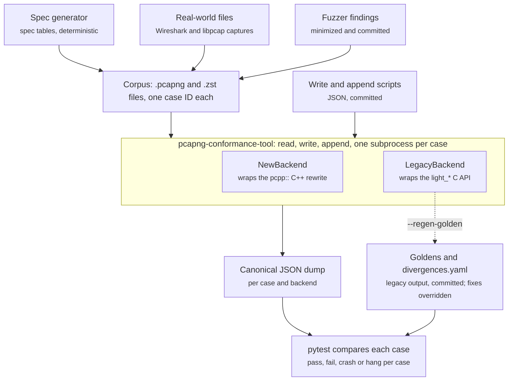

# PcapNgPlusPlus: Conformance Test Plan

This is the working plan for replacing LightPcapNg with a C++14 implementation. Update it in the same PR as the work it describes: tick milestone items, add decisions to the log, and move resolved questions out of the open list.

## Goal and scope

Build a conformance suite, before writing any new code, that proves a C++14 rewrite of LightPcapNg behaves like the current C code: no new bugs, no leaks, no extra memory, no slowdown.

**The contract.** PcapPlusPlus uses 11 functions from `light_pcapng_ext.h`: `light_pcapng_open_read`, `light_pcapng_open_write`, `light_pcapng_open_append`, `light_create_default_file_info`, `light_create_file_info`, `light_free_file_info`, `light_pcang_get_file_info`, `light_get_next_packet`, `light_write_packet`, `light_pcapng_flush`, `light_pcapng_close`. Everything is tested through this boundary.

**The input space is the whole pcapng format.** Reading or appending a file runs the generic block and option parser in `light_pcapng.c` on whatever the file contains. Coverage is therefore defined by pcapng content, not by the API.

**Out of scope.** Code that the 11 functions can't reach is neither tested nor ported. A static call-graph check found 38 such functions (422 of 1257 lines):

- LightPcapNg's other API, which loads a whole file into memory: `light_io.c`, `light_pcapng_cont.c`, and `light_read_from_memory`, `light_pcapng_to_memory`, `light_iterate`, `light_get_block`, `light_get_size` and `light_size`, plus their helpers in `light_internal.c`;
- analysis tools: flow (`light_ip_flow`), subcapture, histogram, `light_pcapng_validate`, `light_pcapng_to_string`, and `light_advanced.c`;
- editing helpers nobody calls: `light_update_option`, `light_alloc_option`, `light_free_option`, `light_free_block`, `light_get_option_code`, `light_get_next_option`.

LightPcapNg's own `src/tests/` is out of scope too. `light_manipulate.c` is only partly out of scope: the writer calls `light_create_option`, `light_add_option` and `light_add_block`.

**Success criteria**

- Every case matches the golden output, except cases listed in `divergences.yaml`.
- Over 95% branch coverage of the legacy code that is reachable from the 11 functions, with every remaining gap explained. Codecov shows coverage of all of LightPcapNg, so this is measured over the reachable functions only; their maximum share of all lines is about 66%.
- Zero leaks and zero sanitizer reports on the full corpus, for both implementations.
- New code's peak heap is at most 110% of legacy's, per case; allocations per packet in steady state are at most legacy's.
- New code's throughput is at least 95% of legacy's on every benchmark.
- Differential fuzzing runs 24 hours with no unexplained mismatch.

## Coverage strategy

Inputs are designed from two angles: the pcapng spec (everything a file can contain) and the legacy code (every branch it takes). Real-world files catch what neither angle predicts.

### Axis 1: the spec

A table-driven Python generator, built from draft-ietf-opsawg-pcapng, emits every block type and every option code defined for each block. That means generic options, SHB, IDB, EPB, ISB and NRB options, and custom options 2988, 2989, 19372 and 19373. Each combination is generated in these variants:

- **Option length:** 0, 1, 2, 3, 4 (to test padding), exactly the space remaining, and the space remaining + 1.
- **Option structure:** `opt_endofopt` missing, `opt_endofopt` followed by trailing junk, option code 0 in the middle, duplicate options.
- **Byte order:** little-endian and big-endian section header.
- **Placement:** an option on a block that shouldn't carry it, such as an SPB.

The legacy parser treats options as generic type-length-value records and interprets only six: SHB comment, hardware, OS and user app; IDB `if_tsresol`; EPB comment. For every other option, a **metamorphic check** applies: inject the option into a valid base file, and the output must equal the base file's output. This needs no golden file.

### Axis 2: the code

Blocks are dispatched in `parse_by_block_type()` (`light_pcapng.c:100`). It has explicit cases for SHB, IDB, EPB, SPB and the LightPcapNg-specific custom block `0xB16B00B5`. Every other block type falls to `default`, which allocates memory and copies the body as raw bytes. Each behavior below needs targeted inputs, and each will be either kept on purpose or listed as a known divergence.

| Behavior | Where | Inputs | Status |
| --- | --- | --- | --- |
| SHB byte-order magic never checked (TODO in source) | `light_pcapng.c:112` | Big-endian files | Generator |
| Options parsed recursively, one stack frame each | `__parse_options` | 10k–100k tiny options; reduced `ulimit -s` | Generator |
| `if_tsresol`: below 128 is 10^n, 128 and above is 2^(n−128), in a `uint32_t` | `light_pcapng_ext.c:158` | 0, 6, 9, 10, 19, 20, 127, 128, 159, 160, 255, zero-length option | Partial: 6 and 9 (corpus, writer); the rest need the generator |
| Timestamp seconds of 0 or above `MAXIMUM_PACKET_SECONDS_VALUE` zeroed | `light_get_next_packet` | Each boundary, at each resolution | Partial: each boundary at 10^9 (`write/timestamps/`); other resolutions need the generator |
| `interface_id` ≥ interface count gives link type `0xFFFF` and timestamp 0 | `light_get_next_packet` | ID = count, `UINT32_MAX` | Generator |
| IDBs beyond `MAX_SUPPORTED_INTERFACE_BLOCKS` dropped | `__append_interface_block_to_file_info` | Max, max+1, packets referencing dropped interfaces | Partial: `too_many_interfaces.pcapng` (read, append), `write/packets/link_types_33` |
| IDBs after packets picked up by the read loop | `light_get_next_packet` | IDB between packets, IDB after last packet | Partial: append's new IDBs come after packets; IDB after the last packet needs the generator |
| Second SHB does not reset the interface list (to verify) | `light_get_next_packet` | Two- and three-section files | Generator |
| EPB and SPB captured length clamped (PcapPlusPlus patches #2180, #2320) | Parse and read paths | Captured length = original length, captured length larger than the block | Partial: SPB (`SpbOverlongOriginalLength.pcapng`); EPB needs the generator |
| Option length validated against remaining space | `__parse_options` | Off by one in each direction, `max_len` ≤ 0 | Generator |
| Raw copy of unknown blocks | `default` case | Block length 12, 13–15, not a multiple of 4, huge | Generator |
| zstd I/O layer | `light_io.c`, zstd | Every block type compressed; frame boundary falling mid-block | Partial: one `.zst` corpus file and `write/compression/`; other block types and a frame boundary mid-block need the generator |
| `read_all_interfaces` rewinds with `fseek()` on the raw file, which doesn't reset the zstd stream, so a compressed file yields no packets (found by the tool) | `light_pcapng_open_read`, `light_set_pos` | Every `.zst` case with `--all-interfaces` | Covered; recorded in the goldens |
| `assert()` aborts on malformed input in Debug builds only; Release reads through | `light_read_record` | Goldens from Release; non-pcapng and truncated inputs | Goldens come from Release builds; the inputs need the generator |
| Timestamps after January 2038 wrap negative where `timespec::tv_sec` is 32-bit, such as 32-bit MinGW (found by CI) | `light_get_next_packet` | `pcapng-example.pcapng` (year 2061); expected failures on those platforms until the new code fixes it | Covered; recorded in the goldens |
| Where `tv_sec` is 32-bit, the writer masks it to 32 unsigned bits, so a negative timestamp is written as a date in 2106 instead of being rejected (found by CI) | `light_write_packet` | `write/timestamps/negative`, `write/timestamps/beyond_max_writable`; expected failures on those platforms | Covered; recorded in the goldens |
| A 65535-byte option (packet or file comment) overflows the heap: the length is padded to a multiple of 4 in a `uint16_t`, which wraps to 0, then 65535 bytes are copied into a 0-byte allocation (found by write cases) | `light_create_option` | `write/comments/length_65535`, `write/fileinfo/comment_length_65535` (recorded as crashes) | Covered; recorded in the goldens |
| An uncompressed file whose name contains `.zst` hangs the reader: the zstd stream never ends (found by write cases) | `read_zstd_compressed` | `write/compression/level_0_zst_name`, `write/compression/level_negative` (recorded as hangs) | Covered; recorded in the goldens |
| Appending to a `.zst` file writes uncompressed blocks after the zstd stream, so the file can no longer be read; the reader hangs (found by append cases) | `light_pcapng_open_append`, `light_open` | `append/.../pcapng-example.pcapng.zst/packets` and `/new_link_type` (recorded as hangs) | Covered; recorded in the goldens |

Measure branch coverage on both implementations. On legacy, it shows the corpus is complete. On the new code, it flags branches the rewrite added that the spec-driven cases don't reach yet.

Coverage of the reachable legacy functions now, with the read, write and append cases: 90.3% of lines (754 of 835) and 68.8% of branches. Most of the remaining gap needs malformed and unusual files, which is the generator's job: the custom block `0xB16B00B5`, truncated and bad-length records, the EPB captured-length clamp, and a zstd frame boundary falling mid-block. Smaller items:

- a coverage upload from a build without zstd, for the fallbacks in `light_compression.c`;
- the write-script option for interfaces in the file info (see Open questions).

### Axis 3: real-world corpus

PcapPlusPlus's 23 `.pcapng`/`.zst` test files are in `corpus/real_world/pcapplusplus/` (Unlicense). Still to import, checking each license before committing:

- Wireshark's test captures
- libpcap's pcapng test files
- hadrielk's pcapng-test-generator output (believed to ship expected decodes; to confirm)

These files are also seeds for the fuzzer.

### Write and append

Write and append cases are JSON scripts; the format is in `conformance/README.md`.

- **Write (56 cases in `cases/write/`):**
  - every `light_create_file_info` field: null, empty, long, non-ASCII, an embedded NUL, and lengths up to 70000;
  - packet data lengths, packet comments, link types (including more than 32), timestamps (including beyond year 2554, and negative), flushes and each compression level;
  - an open failure.
- **Append (70 cases):** 3 scripts in `cases/append/` run against a copy of every corpus file, plus a missing file. Opening a file for append parses it first, so this also runs the parser over the whole read corpus.

Each case's dump covers whether the open succeeded, the output's size and sha256 (uncompressed files only), and a read of the result.

## Test infrastructure

A small C++ tool reduces any backend's behavior on a file to canonical JSON. pytest drives the tool over the corpus and compares the output with committed golden files, which are produced from the legacy backend.



Legacy runs only to record goldens; every normal run checks the new backend against them.

### Repository layout

```
legacy/                     # read-only copy of PcapPlusPlus's 3rdParty/LightPcapNg
│   └── UPSTREAM_COMMIT     # PcapPlusPlus commit it was synced from
src/, include/              # the new implementation (M4)
conformance/
├── README.md               # running the suite, tool usage, dump and script formats
├── requirements.txt        # pytest
├── pytest.ini
├── generator/              # (M1, planned) Python: spec tables -> deterministic corpus + manifest
│   ├── pcapng_spec.py      # block types and option codes
│   ├── builder.py          # block/option writer: endianness, padding, bad lengths
│   └── cases/              # case families: options, blocks, truncation, tsresol, sections...
├── corpus/
│   ├── real_world/
│   │   └── pcapplusplus/   # PcapPlusPlus's 23 test files, at their PcapPlusPlus paths
│   └── regressions/        # (planned) from fuzzing and GitHub issues, committed
├── cases/
│   ├── write/              # 56 write scripts
│   └── append/             # 3 append scripts, each run on every corpus file
├── golden/                 # legacy dumps, committed, regenerated with --regen-golden
│   ├── read/               # <case ID>/<mode>.json
│   ├── write/              # <case ID>.json
│   └── append/             # <corpus case ID>/<script>.json
├── divergences.yaml        # (planned) intentional old != new, each with an issue link
├── tool/                   # pcapng-conformance-tool (C++14)
│   ├── Backend.h/.cpp      # result and script types, the Backend interface
│   ├── LegacyBackend.cpp   # the 11 ext functions, called the way PcapPlusPlus calls them
│   ├── NewBackend.cpp      # (M4)
│   ├── Dump.cpp            # canonical JSON
│   ├── Script.cpp          # write and append script parser
│   ├── Sha256.cpp
│   └── main.cpp            # read, write, append, info
├── third_party/nlohmann/   # json.hpp 3.11.3, vendored
├── memshim/                # (planned) LD_PRELOAD malloc counter (Linux)
└── tests/                  # pytest: test_read, test_write, test_append; metamorphic and differential planned
bench/                      # (planned) Google Benchmark, both backends
fuzz/                       # (planned) FuzzPcapNgDiff.cpp
scripts/sync-legacy.sh      # copy legacy from a PcapPlusPlus commit, then regen goldens
codecov.yml                 # coverage must not drop
.gitattributes              # keeps goldens and corpus files byte-exact
```

If the new code moves into PcapPlusPlus, `src/` and `include/` go there, `conformance/` becomes `Tests/PcapNgConformance`, `fuzz/` merges into `Tests/Fuzzers`, and `legacy/` is deleted.

### Backend interface

```cpp
class Backend {
public:
    virtual ReadResult   read(const std::string& path, bool readAllInterfaces) = 0;
    virtual WriteResult  write(const std::string& path, const WriteScript& script) = 0;
    virtual AppendResult append(const std::string& path, const AppendScript& script) = 0;
};
```

The types are in `conformance/tool/Backend.h`.

- **`ReadResult`:** whether the open succeeded, the file info after open, every packet (interface ID, lengths, link type, timestamp, comment, data), and the interface table after the last packet.
- **`WriteScript` and `AppendScript`:** parsed from JSON files, so write and append cases are data, not code.
- **`WriteResult` and `AppendResult`:** whether the open succeeded; append also returns the file info it found.

The tool, not the backend, examines the written file and reads it back with the same backend.

### Canonical dump

The format is specified in `conformance/README.md`. Its main properties:

- **Byte-stable on every platform:** stable field order, one compact line per packet and interface, `\n` line endings.
- **Packet bytes** appear as hex up to 256 bytes and as sha256 above that.
- **Raw-byte strings** (comments, SHB strings) are written one code point per byte, U+0000 to U+00FF, so the exact bytes survive.
- **Unwritten header fields are visible:** before each read, the packet header is filled with `0xA5`, so a field a backend doesn't write shows up as that pattern instead of as stack garbage.
- **Write and append** report the output's size and sha256, uncompressed files only, and a re-read dump of the file.
- Legacy and new code never share a symbol: legacy keeps its `light_*` C names, new code lives in `pcpp::`.

### Goldens and divergences

- Goldens are generated once from the legacy backend with `--regen-golden` and committed. Regenerating needs a Release build with zstd and a 64-bit `timespec::tv_sec`; `scripts/sync-legacy.sh` does it after each sync.
- A case where legacy crashed is recorded as `{"crash": true}`, and one where it hung as `{"hang": true}`. For those cases, the new backend must return a clean error.
- `divergences.yaml` overrides the golden for intentional bug fixes. Each entry has a case ID, an issue number, a reason and the expected dump. It also serves as the migration changelog.
- After legacy is deleted, the goldens become the spec and the rest of the suite runs unchanged.

### pytest layer

- (Planned) A session fixture runs the generator into a temp directory. Generated `.pcapng` files are not committed.
- One subprocess per case and operation, so crashes and hangs are reported per case.
- Test IDs look like `test_read[real_world/pcapplusplus/.../igmp.pcapng/default]`, `test_write[comments/length_255]` and `test_append[real_world/.../igmp.pcapng/packets]`.
- Modules:
  - existing: `test_read`, `test_write`, `test_append`, each with a stale-golden check;
  - planned: `test_metamorphic`, and `test_differential` (skipped when legacy isn't built).
- Options:
  - existing: `--tool-path`, `--backend`, `--regen-golden`, `--case-timeout` (default 10 seconds, 3 when the golden is a hang);
  - planned: `--sanitizer-mode`.
- Platform rules:
  - cases that need zstd are skipped on builds without it;
  - where `tv_sec` is 32-bit, cases whose timestamps can't be represented are strict expected failures.

## Memory and performance

Memory and speed are compared against legacy baselines recorded on the same machine. Leaks are a hard zero; size and speed have tolerances.

### Memory

- **Leaks and memory errors:** ASan, LSan and UBSan build of the tool, full corpus, both backends. Any sanitizer report fails the run.
- **Allocation profile (Linux):** a small `LD_PRELOAD` shim counts `malloc`, `calloc`, `realloc` and `free` calls, peak live bytes, and bytes still outstanding at exit, and writes them as sidecar JSON. Legacy numbers are committed to `golden/memory/`.
- **Gates:** per case, peak bytes ≤ 110% of legacy; allocations per packet in steady state ≤ legacy; outstanding bytes at exit = 0.
- **Stack:** the many-options cases run under a reduced `ulimit -s`, because the legacy option parser recurses once per option.

### Performance

The benchmarks in `bench/` use Google Benchmark (pulled in with `FetchContent` only when the option is on) and link both backends through `Backend`.

| Benchmark | Input |
| --- | --- |
| Read, small packets | 1 GB, 64-byte packets |
| Read, jumbo packets | 1 GB, 9000-byte packets |
| Write, small and jumbo | Same as above |
| zstd read and write | Same as above, compression levels 1, 5, 10 |
| Append | 100 MB onto 1 GB |
| Open, many interfaces | Interface count at `MAX_SUPPORTED_INTERFACE_BLOCKS` |
| Option-dense read | 20 options per EPB |

Inputs are generated at build time, never committed. The gate is the new/legacy time ratio measured in the same run, not an absolute time. Runs are nightly or on demand.

## Fuzzing

A differential libFuzzer target finds the inputs nobody thought to generate, and each finding becomes a permanent regression case.

- `fuzz/FuzzPcapNgDiff.cpp` reads each input with both backends and calls `abort()` when the canonical dumps differ. It applies the same divergence rules as `divergences.yaml`.
- Seeds: the generated corpus, the real-world files, and PcapPlusPlus's existing OSS-Fuzz pcapng corpus (used by `Tests/Fuzzers/FuzzTarget.cpp`).
- Each crash or mismatch is minimized and added to `conformance/corpus/regressions/` with a golden dump.
- After legacy is deleted, a single-backend target replaces it in OSS-Fuzz.

## Build and CI

The suite builds behind its own CMake options and runs on every PR, with coverage. Fuzzing and benchmarks will run nightly.

- CMake options:
  - existing: `PCAPNGPP_BUILD_CONFORMANCE` (the tool, on by default), `PCAPNGPP_BUILD_COVERAGE`, and legacy's `LIGHT_PCAPNG_ZSTD`;
  - planned: options for benchmarks and the fuzz target.
- The default build type is Release, as in PcapPlusPlus.
- `legacy/` builds as its own target, `light_pcapng_legacy`, until it is deleted.

| When | Job | Platforms | Status |
| --- | --- | --- | --- |
| Every PR | Build, plus the pytest conformance suite | Linux (9 images, GCC and Intel icx), macOS, Visual Studio (Win32, x64, ARM64), MinGW, FreeBSD; Android and the macOS cross-compile build only | Running, legacy backend; the new backend in M4 |
| Every PR | gcovr line and branch coverage of all of `legacy/LightPcapNg`, uploaded to Codecov (must not drop) and as an HTML artifact | Linux | Running |
| Every PR | `legacy/` matches PcapPlusPlus `master` (warns when a sync is needed) | Linux | Running |
| Every PR | ASan, LSan and UBSan over the full corpus | Linux | Planned (M3) |
| Every PR | Allocation profile against baselines | Linux | Planned (M3) |
| Every PR, during migration | Differential tests, legacy vs new | Linux | Planned (M4) |
| Nightly | Differential fuzzing, 30 minutes | Linux | Planned (M4) |
| Nightly | Benchmarks, ratio gate | Linux | Planned (M3) |

## Milestones

The suite is built and green against legacy (M1–M3) before any new code is written (M4). The new implementation then has a fixed target to meet.

### M1: Skeleton, end to end

- [x] `legacy/` copied from PcapPlusPlus, `UPSTREAM_COMMIT` recorded, `scripts/sync-legacy.sh`
- [ ] Generator: `builder.py` and spec tables for SHB, IDB, EPB, SPB, with generated files fed through `test_read`
- [x] Tool with `LegacyBackend` and canonical JSON dump (read only)
- [x] pytest runner with per-case subprocess, golden compare, `--regen-golden`
- [x] PcapPlusPlus's existing 23 `.pcapng`/`.zst` fixtures pass through the loop, on every CI platform that can run the tool
- [x] Top-level CMake and a first CI workflow (build only; tests get added as they land)

### M2: Full corpus

- [ ] All spec block types and option codes, with length, structure and byte-order variants
- [ ] Metamorphic tests for uninterpreted options
- [ ] One case family per row of the Axis 2 table
- [ ] Truncation at every byte and bit flips in length fields
- [x] Write operation with `WriteScript` cases (56 cases: file info, packets, comments, timestamps, flush, compression, open failure)
- [x] Append operation: 3 append scripts × every corpus file, plus a missing file (70 cases)
- [ ] Real-world corpus imported, licenses checked (PcapPlusPlus's files are in; Wireshark, libpcap and pcapng-test-generator remain)

### M3: Measure the baseline

- [x] Coverage job: gcovr over all of `legacy/LightPcapNg`, uploaded to Codecov on every PR
- [ ] Second coverage upload from a build without zstd, for the `light_compression.c` fallbacks
- [ ] Close coverage gaps until over 95% of reachable branches are covered (now 68.8%; most of the gap needs the generator)
- [x] Inputs where legacy crashes or hangs are recorded as `crash` and `hang` goldens
- [ ] ASan, LSan and UBSan job over the full corpus
- [ ] Memory shim and legacy baselines committed
- [ ] Benchmarks and legacy baseline numbers
- [ ] Known legacy bugs triaged into `divergences.yaml`

### M4: New implementation

- [ ] `NewBackend` wired into the tool
- [ ] Differential fuzz target running nightly
- [ ] All goldens and divergences pass, memory and performance gates pass
- [ ] Coverage of new code reviewed for untested branches

### M5: Switch over

- [ ] Decide: standalone library or merged into PcapPlusPlus
- [ ] PcapPlusPlus defaults to the new code; legacy still selectable for one release
- [ ] 24 hours of differential fuzzing with no unexplained mismatch
- [ ] Delete legacy; drop the differential jobs; move the single-backend fuzzer to OSS-Fuzz

## Open questions

- [ ] Must the new writer produce byte-identical files, or is "both readers decode each other's output identically" enough?
- [ ] Big-endian files: keep legacy's misparse, or fix it and record a divergence?
- [ ] Multi-section files: should a new SHB reset the interface list (spec behavior)?
- [ ] Should the new code interpret more options (`if_tsoffset`, `epb_flags`), or keep the legacy subset for now?
- [ ] Does the C ext API stay as a compatibility shim, or does PcapPlusPlus move straight to a C++ interface?
- [ ] Memory and performance tolerances: are 110% peak heap and 95% throughput the right numbers?
- [ ] Are the external corpora's licenses compatible with committing their files? (PcapPlusPlus's are: Unlicense.)
- [ ] Should write scripts be able to put interfaces in the file info passed to `light_pcapng_open_write()`? The ext API allows it, and it covers the loop that writes those IDBs, but PcapPlusPlus never does it.
- [ ] Which legacy bugs should the new code fix rather than reproduce (the 65535-byte option overflow, the `.zst` hangs, the 32-bit timestamp handling)? Each fix becomes a divergence entry.
- [ ] Final home of the new implementation: its own library, or inside PcapPlusPlus?

## Decision log

| Date | Decision | Why |
| --- | --- | --- |
| 2026-11-27 | Separate repo holding the suite, a pinned copy of legacy, and the new code | The comparison needs both implementations side by side; neither needs PcapPlusPlus to build |
| 2026-11-27 | Test only through the 11 ext functions, with inputs covering the whole pcapng format | That is all PcapPlusPlus uses, but any file reaches the full parser |
| 2026-11-27 | Goldens are generated from legacy and committed | The suite must outlive the legacy code |
| 2026-11-27 | Per-case subprocess driven by pytest | Legacy crashes on some inputs; one crash mustn't kill the run |
| 2026-11-27 | Don't port code that PcapPlusPlus can't reach | It's out of scope and only adds risk |
| 2026-11-27 | `legacy/` is a verbatim copy of all of `3rdParty/LightPcapNg`, including out-of-scope files, built with its own upstream `CMakeLists.txt` | The sync check stays a plain directory diff, and legacy builds exactly as PcapPlusPlus builds it |
| 2026-11-27 | CI builds on PcapPlusPlus's platform matrix (Linux distros, macOS, Visual Studio, MinGW, FreeBSD, Android), with zstd on where available | The rewrite has to work everywhere PcapPlusPlus ships LightPcapNg today |
| 2026-11-28 | Default build type is Release, and goldens come from a Release build | That is what PcapPlusPlus ships; in Debug, legacy's `assert()` calls abort on inputs that Release reads through |
| 2026-11-28 | The read dump has no `end` (`Eof`/`Error`) field | `light_get_next_packet()` returns 0 in both cases, so the API can't tell them apart |
| 2026-11-28 | The tool fills the packet header with `0xA5` before each read | Fields a backend leaves unwritten become deterministic and visible instead of stack garbage |
| 2026-11-28 | The dump records the interface table both after open and after the last packet | Interface blocks between packets are picked up by the read loop, and only the second snapshot shows it |
| 2026-11-28 | The tool uses nlohmann/json 3.11.3, vendored as a single header in `conformance/third_party/` (the copy PcapPlusPlus bundles) | Write cases will be JSON files the tool must parse, and a library gets escaping right; vendoring needs no network at configure time |
| 2026-11-28 | Dumps put each packet and interface on one compact line | A golden diff points at the packet that changed |
| 2026-11-28 | The tool has its own small SHA-256 | PcapPlusPlus's bundled hash library has only MD5, and a crypto dependency for one hash isn't worth it |
| 2026-11-28 | All 23 PcapPlusPlus `.pcapng`/`.zst` files go in the corpus, at their PcapPlusPlus paths under `corpus/real_world/pcapplusplus/` | They are small (about 156 KB), Unlicense-licensed, and each can be traced to the PcapPlusPlus test that uses it |
| 2026-11-28 | A case ID is the file's path under `corpus/`, and its goldens are `golden/read/<case ID>/<mode>.json`, one per open mode | `pcapng-example.pcapng` and `pcapng-example.pcapng.zst` share a directory, so the extension has to be part of the ID |
| 2026-11-28 | A crash is recorded as `{"crash": true}`, without exit code or signal | Exit codes and signals differ between platforms; the failure message still shows them |
| 2026-11-28 | `pcapng-conformance-tool info` reports the backends and whether zstd is built in; pytest skips `.zst` cases without it, and `--regen-golden` refuses to run without it | Builds without zstd can't read `.zst` files, and goldens must never be recorded from one |
| 2026-11-28 | `.gitattributes` keeps goldens and corpus files byte-exact | A Windows checkout with `core.autocrlf` would otherwise turn goldens into CRLF |
| 2026-11-28 | Where `tv_sec` is 32-bit, a case is a strict expected failure only if its golden has a timestamp outside that range; goldens keep the correct 64-bit value and can't be regenerated on such a platform | Every other case still has to pass on 32-bit MinGW, the new code can fix the wraparound without a divergence entry, and a strict mark fails the run once a case starts passing |
| 2026-11-28 | Coverage is measured with GCC `--coverage` and gcovr, and uploaded to Codecov | The same tools as PcapPlusPlus; Codecov collects, summarizes and visualizes the data |
| 2026-11-28 | Coverage counts every compiled `legacy/LightPcapNg` file in full, with no exclusions | The number shown is the real one; about a third of the lines (in functions the 11 ext functions never call) can't be covered, so the reachable maximum is about 66% of lines and 71% of branches |
| 2026-11-28 | One Linux coverage job (zstd on), not one per platform | Legacy has no platform-specific code paths, only min/max macro workarounds; platform differences in behavior are caught by the goldens on every platform |
| 2026-11-28 | Write cases are JSON scripts in `conformance/cases/write/`, run by a `write` tool operation that fills the packet header as PcapPlusPlus does | Write cases are data, not code; filling the header the same way reaches the same legacy paths PcapPlusPlus does |
| 2026-11-28 | A write dump records the written file's size and sha256 only when uncompressed, plus a read of the file back | Compressed bytes depend on the zstd version, which differs across platforms; the read checks the content either way. Recording the sha256 separately leaves the open byte-identical-writer question open |
| 2026-11-28 | A hang is recorded as `{"hang": true}`, like a crash, with a 10-second default timeout and 3 seconds when the golden is a hang | Legacy hangs on some inputs; recording it documents the bug and gives the new code a target, without slowing every run |
| 2026-11-28 | Append cases run every append script against a copy of every corpus file, and the tool reads the result back | `light_pcapng_open_append()` parses the whole file first, so this runs the parser over the whole read corpus, as the plan requires |
| 2026-11-28 | Plan updated after M1 and the write and append paths: status columns, the actual layout and interfaces, and the reachable-code list | Keep the plan describing what exists, and mark what is still planned |
